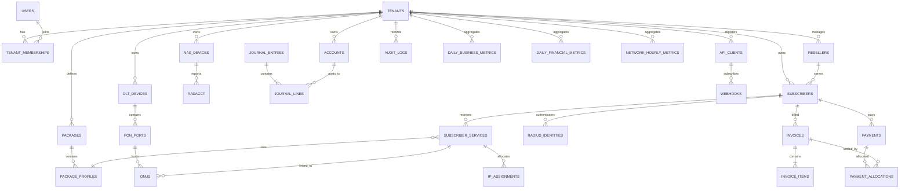

# ISP Enterprise Control Center — Logical ERD

## Tenant isolation rules
- Every tenant-owned row carries `tenant_id`.
- Composite foreign keys include `tenant_id`, preventing cross-tenant references.
- PostgreSQL RLS uses transaction-local `app.tenant_id`.
- Runtime roles must not own tables and must not have `BYPASSRLS`.
- RADIUS resolves tenant from the NAS source IP and canonical realm-qualified username; it must not trust an unverified tenant hint from a client.
- Platform operators use a separate, audited control-plane path; they do not bypass tenant scoping in ordinary business queries.

## RADIUS hybrid model
FreeRADIUS performs protocol handling and accounting packet processing. The control plane owns tenant provisioning, credentials/secret references, package policy, NAS registry, CoA workflows and operational audit. FreeRADIUS SQL queries must be customized for the tenant-aware schema and validated against the exact FreeRADIUS release before any NAS migration.

## Accounting invariants
- Posted journal entries are immutable.
- A posting transaction verifies sum(debit_minor) = sum(credit_minor) per currency.
- Corrections use reversal entries.
- Payment-to-invoice allocation is many-to-many.
- Gateway clearing and settlement are distinct events.
